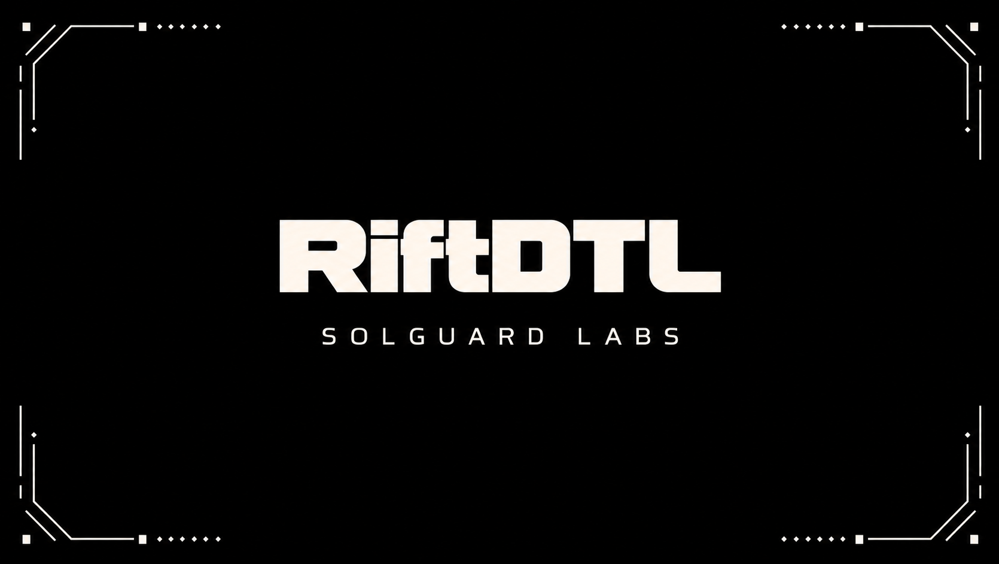

# RiftDTL



RiftDTL is a CTF lab for a Go-based distributed transfer ledger. Each economic
shard keeps a local ledger, while a central reconciler consolidates cross-shard
state and exposes a withdrawal rail.

The intended vulnerability is a reconciliation priority bug. Debits are applied
by arrival order, but destination credits are grouped and published before
origin solvency is final. During that checkpoint a credited destination account
can withdraw liquidity that is not yet backed by a finalized debit.

## Run

```bash
npm test
```

Useful commands:

```bash
npm run build
./out/riftdtl --list
./out/riftdtl scenario exploit-window
./out/riftdtl validate baseline
```

`scripts/build.mjs` uses `go` from PATH or `GO_BIN`. The local `npm test`
script can reuse an existing `out/riftdtl.exe` when no compiler is installed.

The challenge entrypoint is the `exploit-window` scenario. The TypeScript tests
exercise normal transfer, shard closure, grouped reconciliation, withdrawal, and
the critical liquidity creation window.
