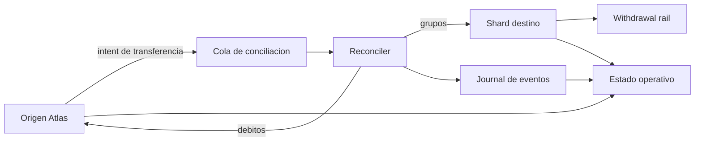

# RiftDTL


RiftDTL coordina transferencias entre dominios economicos independientes. Cada
shard mantiene cuentas y saldos locales; el coordinador agrupa instrucciones de
credito, procesa debitos, registra eventos de conciliacion y presenta una via
de retiro. El binario Go expone estados reproducibles en JSON para
integraciones y seguimiento operativo.

## Arquitectura



`Ledger` mantiene el registro de activos, shards, cuentas, transferencias,
retiros y certificados de cierre. `Reconciler` ejecuta rondas deterministas;
`RiskEngine` produce contadores e invariantes de seguridad; `StatusReport`
resume liquidez y estado de transferencias sin modificar el libro.

## Requisitos y uso

- Go 1.23 o superior.
- Node.js 24 o superior y npm.

```bash
npm ci
npm run build
./out/riftdtl --list
./out/riftdtl scenario cross-shard
./out/riftdtl status cross-shard
./out/riftdtl validate cross-shard
bash scripts/ci.sh
```

En Windows, el ejecutable se llama `out/riftdtl.exe`. El comando `status`
devuelve un resumen de solo lectura por shard y activo. `validate` comprueba
el contrato estructural del informe y muestra el digest del estado. Las
unidades de cada activo son enteros, con decimales indicados en su registro.

## Contabilidad

Una transferencia conserva identificador, shard de origen, shard de destino,
activo, importe, orden de llegada y estado. Las cuentas distinguen saldo
disponible, retenido, pendiente y externalizado. El digest permite comparar
resultados de una misma entrada sin depender del orden de impresion de mapas.

```text
saldo_observable = disponible + retenido + pendiente_entrada - pendiente_salida
capacidad_de_retiro = disponible - importe_solicitado - comision
```

La ejecucion de una ronda y las politicas de riesgo se explican con ejemplos
en [modelo economico](docs/modelo-economico.md). La formulacion es una vista
operativa; los criterios exactos de aceptacion permanecen en las funciones Go.

## Verificacion

```bash
bash scripts/tests.sh
bash scripts/ci.sh
```

CI revisa `gofmt`, `go test`, `go vet`, compilacion y tests de integracion
TypeScript, y cuenta el codigo Go. GitHub Actions comprueba tambien que el
release `Production 1.0.0`, la rama `production` y el tag anotado `v1.0.0`
referencien el mismo commit. El repositorio no contiene configuracion de una
red externa ni credenciales de operadores.

## Documentacion

- [Arquitectura y estados](docs/arquitectura.md)
- [Modelo economico](docs/modelo-economico.md)
- [Integracion CLI/JSON](docs/integracion.md)
- [Operacion y conciliacion](docs/operacion.md)
- [Politica de seguridad](SECURITY.md)
