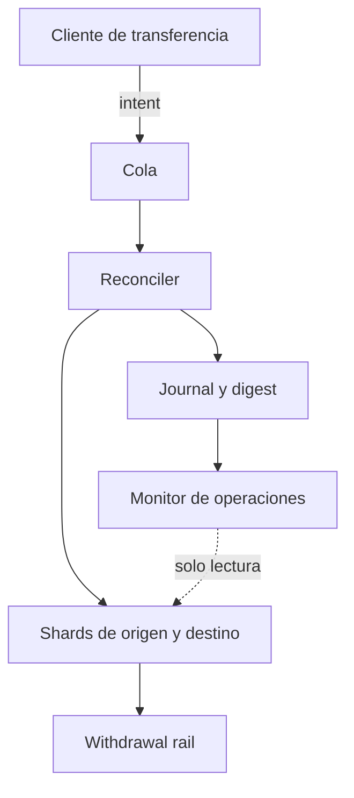

# Politica de seguridad

RiftDTL separa la admision de intenciones, la conciliacion por ronda, los
retiros y el cierre de shards. La integridad de un estado publicado depende de
que activos, cuentas y certificados correspondan a la misma revision del
libro. Las vistas de estado no tienen permisos de escritura.

## Limites de confianza

La entrada de un cliente no constituye una confirmacion de saldo. El
coordinador aplica controles de activos registrados, vinculos entre shards,
identificadores y estados de cierre. Los retiros pasan por el motor de
autorizacion y quedan enlazados al registro de transferencia correspondiente.

## Invariantes y controles

- Saldos disponibles, retenidos y pendientes nunca son negativos.
- Los enlaces de transferencia y de cierre apuntan a entidades existentes.
- Los informes conservan un digest del estado y una secuencia de eventos.
- La suma por shard de saldos disponibles coincide con la vista de red para
  cada activo.
- Los certificados de cierre exigen el estado adecuado y no admiten nuevas
  salidas desde un shard cerrado.

La suite publica valida flujos nominales de conciliacion, retiro, cierre,
formato JSON y resumen operativo. Los contadores de riesgo del informe
facilitan investigacion de divergencias; una alerta requiere comprobar sus
eventos y el estado de origen antes de tomar decisiones operativas.

## Dependencias y cambios

`go.mod` fija la version minima de Go y `package-lock.json` fija las
dependencias de desarrollo Node. Dependabot revisa Go, npm y acciones de CI.
Los cambios de politica o contabilidad requieren tests de transicion de
estado, comparacion de digest y revision del modelo economico documentado.

## Reporte responsable

Un reporte debe incluir: commit o tag observado, comandos reproducibles,
entrada y salida JSON, secuencia de eventos, activos/unidades afectados e
impacto economico verificable. No adjunte credenciales ni datos de terceros.
El repositorio no publica canales de despliegue ni autoriza operaciones sobre
infraestructura externa.
