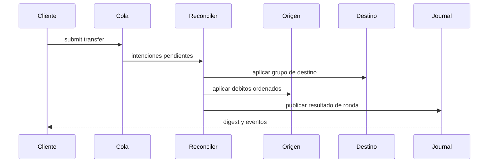
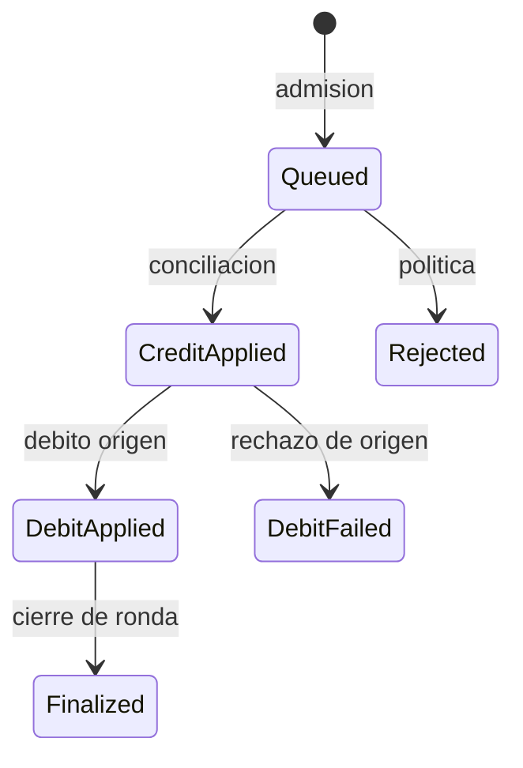

# Arquitectura de RiftDTL

RiftDTL es un coordinador de libro distribuido con cinco shards economicos en
el entorno de referencia. Los componentes son ejecutables en un unico binario,
pero mantienen fronteras de estado explicitas para poder verificar cada
transicion.

| Componente | Responsabilidad | Datos principales |
| --- | --- | --- |
| `AssetStore` | Parametros de activo | ID, decimales, comisiones y peso de riesgo |
| `ShardStore` | Dominios y cuentas | Estado, revision, buffers y saldos |
| `TransferStore` | Ciclo de transferencias | Origen, destino, importe y orden |
| `ReconcileQueue` | Trabajo por ronda | Intenciones pendientes |
| `Reconciler` | Conciliacion | Grupos, debitos y trazas |
| `WithdrawalEngine` | Salidas | Solicitud, aprobacion y finalizacion |
| `ClosureEngine` | Cierre de dominio | Certificado y digest |
| `RiskEngine` | Telemetria | Contadores e invariantes |
| `StatusReport` | Lectura operativa | Liquidez por shard y activo |

## Identidad y revisiones

Cada activo, cuenta y shard tiene ID normalizado. Una transferencia incluye
un nonce y una clave de cola; las trazas de ronda conservan `step`, `phase`,
`subject` y el identificador de transferencia. El digest de estado permite
comparar una ejecucion con otra a partir de la misma entrada.

## Estados

Una cuenta distingue `available`, `held`, `pending_in`, `pending_out`,
`withdrawn` y `externalized`. Los certificados de cierre pertenecen al shard
y se verifican con el digest correspondiente. Las vistas `scenario` y
`status` son proyecciones de lectura del mismo libro, no libros paralelos.

## Limites del paquete

El binario genera escenarios deterministas y JSON local. No incluye firmas,
direccion de contrato, endpoint de red ni transportes de mensajeria externos.
Una integracion debe aportar su propio control de acceso y persistencia de
eventos antes de conectar un origen de datos distinto al de referencia.
