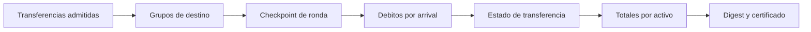

# Modelo economico

Los activos USDQ y EURQ tienen seis decimales en el registro local; RIFT tiene
ocho. Los ejemplos de CLI usan enteros en unidades minimas, no valores con
coma flotante. Las comisiones usan puntos basicos con denominador `10_000`.

```text
cargo = floor(importe * fee_bps / 10_000)
debito_total = importe + cargo
```

El origen debe poder cubrir el debito total. El destino contabiliza el
importe de transferencia. La diferencia corresponde al tratamiento de
comisiones definido para el activo y la politica de la ronda.

## Ronda de conciliacion

La politica de referencia agrupa instrucciones por shard, cuenta y activo de
destino, y procesa debitos por `arrival`. El informe de ronda expone grupos,
aplicaciones de debito, retiros asociados, decisiones y traza ordenada. Las
proyecciones de riesgo muestran supply de apertura, supply observado y
contadores de liquidacion por activo.



Un ejemplo nominal es `cross-shard`: una transferencia USDQ desde Atlas a
Boreal conserva el importe en la red mientras cambia su distribucion por
shard. `reconciliation` ejercita tres instrucciones, agrupadas en dos
destinos, y publica su orden de llegada `2, 5, 8`. El grupo Boreal suma
`180_000` unidades USDQ; los debitos nominales agregan `305_000`.

## Retiro y externalizacion

Un retiro autorizado reduce el disponible de la cuenta y aumenta el importe
externalizado; el evento conserva activo, shard, cuenta y transferencia de
origen. Para conciliar supply se considera tambien el activo externalizado:

```text
supply_observado = disponible + retenido + externalizado
delta_supply = supply_observado - supply_apertura
```

Los saldos pendientes se conservan como estados intermedios separados. Un
informe de `status` muestra liquidez por shard y activo; no reemplaza la
traza detallada de `scenario` para analizar una transicion.

## Politicas y riesgo

`ReconcilePolicy` explicita agrupacion, orden de debito, publicacion de
checkpoint y tratamiento de retiros. Los contadores de riesgo son
instrumentacion de observabilidad, no permisos operativos. Antes de concluir
que una ronda se ha cerrado correctamente, compruebe la secuencia de eventos,
los estados de transferencias y la suma de activos de todos los shards.
