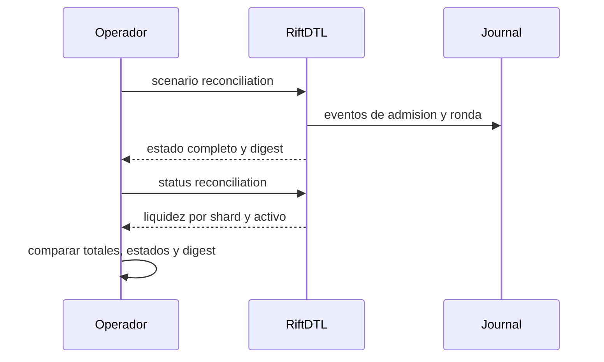

# Operacion y conciliacion

El proceso operativo usa un unico snapshot por escenario y conserva la traza
de cada ronda. Los equipos de integracion pueden usar `status` para vigilancia
rapida y `scenario` para reconstruir transiciones.



## Comprobaciones de cierre

1. Confirmar que el escenario previsto y el identificador de red coinciden.
2. Verificar que `validate` devuelve `ok <escenario> <digest>`.
3. Comparar los contadores de transferencias con la lista detallada.
4. Reconciliar disponible, retenido y externalizado por activo y shard.
5. Revisar eventos de retiro y certificados antes de cerrar una ventana.

## Indicadores

| Indicador | Lectura operativa |
| --- | --- |
| Transferencias pendientes | Trabajo aun no cerrado |
| Debitos fallidos | Requieren investigacion de saldo y orden |
| Liquidez retenida | No disponible para nuevas instrucciones |
| Buffer de settlement | Capacidad de absorcion por shard |
| Delta de supply | Diferencia frente al snapshot de apertura |

Las alertas no sustituyen la inspeccion de transferencias individuales. Para
un incidente, conserve binario, entrada, JSON completo, digest, hora y commit
exacto. No publique datos de clientes o credenciales en incidencias.

## Verificacion de release

```bash
bash scripts/ci.sh
```

El pipeline comprueba formato Go, tests Go, analisis estatico, compilacion
del binario, tests TypeScript y LOC Go. El workflow de integridad comprueba
que `main`, `production` y `v1.0.0` sean el mismo commit. El release es un
artefacto de codigo; no representa un despliegue automatico en infraestructura
externa.
